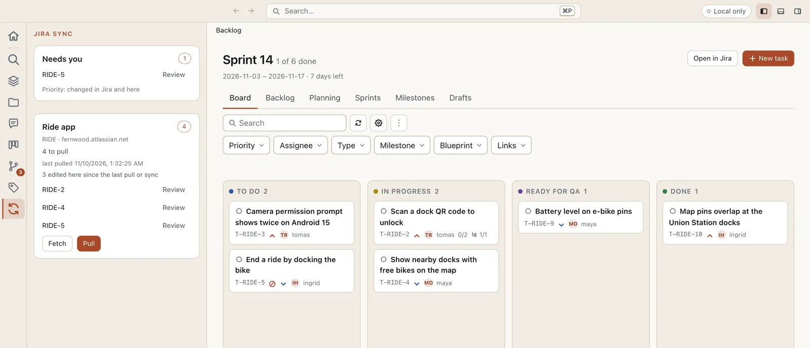
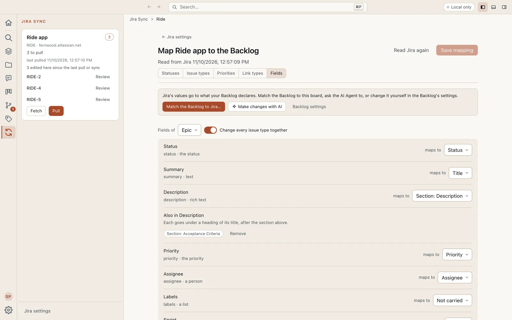
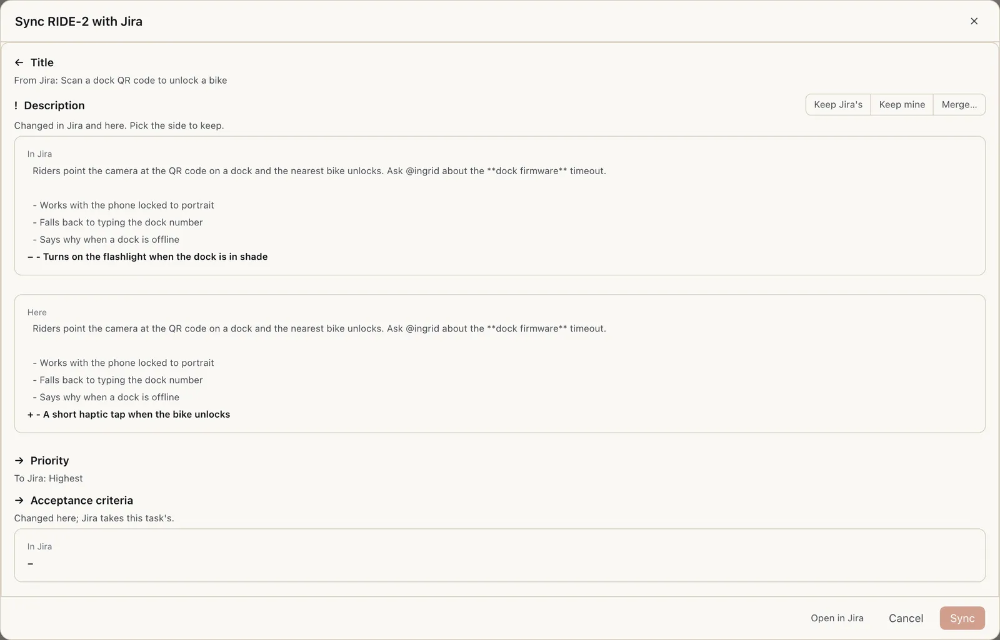
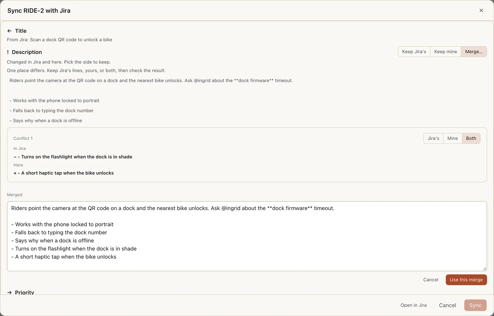

# Jira Sync for Eidos MD

Bring your team's Jira board into your Eidos root, and send your work back. Every issue becomes a task in the Backlog, every comment thread comes with it, and your sprints come with them, so you plan and work next to the blueprints while the board stays where your team keeps it.



The board above is a Jira board pulled into the Backlog: its columns, its sprint, and its people. The Jira Sync sidebar beside it says what is waiting in Jira, which tasks you changed here, and what needs you.

- **See it before it lands.** A fetch shows what changed in Jira since your last pull and writes nothing. A pull brings it in.
- **Your mapping, your words.** Jira's statuses, issue types, priorities, and fields map onto your Backlog's, on a mapping page of their own. The plugin drafts the mapping and you change any entry.
- **Comments, signed and dated.** Each issue's comments arrive as one thread on its task, signed by the people who wrote them, with their mentions, formatting, and screenshots.
- **Send your changes back, one ticket at a time.** A sync brings a task and its issue level field by field: what changed in Jira comes in, what you changed goes out, and anything changed on both sides waits for you. You see the whole plan first, both sides of a text in full, and nothing is written over unseen.
- **Merge like git.** A section changed in Jira and in Eidos is settled conflict by conflict: keep Jira's lines, yours, or both, and edit the result before it goes.
- **Acceptance criteria in the description.** Bundle several sections into one Jira field: the description first, then each other section under its own heading, a checklist as Jira checkboxes, split back apart on a pull.
- **Make a ticket from a task**, with the issue type and anything Jira requires chosen in the page.
- **Keep some work in Eidos.** Mark a task **Don't sync** and Jira and the task leave each other alone.
- **Sync on its own, when you trust it.** Off until you turn it on: after each save, after each push, or both. Anything to settle waits under **Needs you**.
- **Private by design.** It runs on your machine and talks straight to your Jira site with your own API token. There is no server in between.

## Get started

You need Eidos MD 0.21.0 or later, with the Backlog and Comments plugins on, and a Jira Cloud site (`your-site.atlassian.net`).

1. **Install it.** Open **Settings → Community plugins → Browse**, find **Jira Sync**, and choose **Install**, then **Enable**.
2. **Make an API token.** At [id.atlassian.com](https://id.atlassian.com/manage-profile/security/api-tokens), choose **Create API token** (the classic one, not the one with scopes) and copy it.
3. **Sign in.** Open the plugin's settings page: **Settings → Community plugins → Jira Sync**, or **Jira settings** at the foot of the Jira Sync sidebar. Under **Account**, in **Sign in to a Jira site**, fill in **Site**, **Email**, and **API token**, and choose **Sign in**. The token is kept only once Jira accepts it. Turn on **Make this your default sign-in for all roots** if every root on this machine should use it.
4. **Connect a board.** Under **Boards**, pick one from **Choose a board** (the boards your account can read in Jira) and choose **Connect**. Or paste the board's address from Jira (`…/projects/KEY/boards/12`) under **Or paste a board's address**.
5. **Map it.** Choose **Edit mapping** beside the board. Its mapping page lists each Jira status, issue type, priority, and link type with the Backlog value it maps to, and each issue type's fields with where they land. Change any entry, then **Save mapping**. If your Backlog doesn't have Jira's statuses, types, or priorities yet, **Match the Backlog to Jira…** adds them for you (see [Match the Backlog to Jira](#match-the-backlog-to-jira)).
6. **Fetch, then pull.** Open the Jira Sync sidebar from its icon in the Activity Bar. **Fetch** says what a pull would add and change; **Pull** brings it in.



The mapping page is where Jira's words become yours. Each row is one Jira value or field, and **maps to** says where it lands in the Backlog; **Not carried** leaves a field in Jira.

## Everyday work

### Fetch and pull

The Jira Sync sidebar holds a card for each connected board: how many changes wait in Jira, when you last pulled, and the tasks edited here since their last pull or sync, each with **Review**. **Fetch** reads Jira and writes nothing. **Pull** writes what changed into the Backlog, comments included. Turn on **Fetch automatically** on the settings page to fetch every 5, 15, 30, or 60 minutes while the app has the root open; nothing pulls on its own.

### Work a ticket

Open a task the Backlog shows and its Jira panel sits beside it, in the auxiliary sidebar: whether it is in Jira, what a sync would carry each way, read again a moment after you edit, and **Sync with Jira…**, **Open in Jira**, or **Create in Jira…** for a task not in Jira yet.


The comments came from Jira, each signed by the person who wrote it, with their mentions turned into the root's people. New replies you write in the issue's thread are sent as your account at the next sync; nobody else's are.

### Sync a ticket

**Sync with Jira…** on the panel (or **Review** in the sidebar) opens the sync review: each field that moves, `←` from Jira, `→` to Jira, `!` changed on both sides. A text shows Jira's version and yours line by line, the lines only one side holds marked. Nothing is sent until you choose **Sync**.



- **Conflicts are yours to settle.** A field changed in both places stops that ticket until you pick **Keep Jira's** or **Keep mine**.
- **Merge a section.** For a section, **Merge…** goes conflict by conflict: **Jira's**, **Mine**, or **Both**, then edit the merged text and choose **Use this merge**.
- **Statuses go through your workflow.** A sync uses Jira's transitions, asks for what a transition screen needs, and never picks between statuses your mapping folds together without you.
- **Rich text survives.** A description goes back with every paragraph you did not touch exactly as Jira holds it, panels, mentions, and screenshots included. A rewrite that would drop one says so and waits for you to agree.
- **Owned fields.** Mark a field as Eidos's and a pull never overwrites it; a change made to it in Jira becomes a conflict at the next sync.



### Make an issue from a task

**Create in Jira…** on a task's panel shows the plan first: the board, the issue type, and anything Jira requires, each chosen in the page. Choose **Create** and the task becomes the issue's. It makes nothing while something stops it, and a create cut short is found again by a mark on the issue, never made twice.

### Don't sync

Turn on **Don't sync** on a task's panel to keep it in Eidos: no pull writes the task and nothing of it goes to Jira. Turn it off to bring it back.

### Auto sync

Each person's, off by default, on the settings page under **Options**:

- **Sync a task after it is saved**: a task edited here goes to Jira a few seconds after its last save.
- **Sync after a push**: every task edited here goes to Jira once the app pushes.

Both run only while the app has the root open, only for tasks edited here, never for one marked Don't sync. A sync that finds anything to settle writes nothing: the task goes under **Needs you** in the Jira Sync sidebar with what stops it, a notification says so once, and **Review** settles it.

## Match the Backlog to Jira

The mapping page's **Match the Backlog to Jira…** makes the Backlog's statuses, priorities, and task types follow the board, two ways:

- **Add and rename** adds what Jira has and the Backlog lacks, and renames a Backlog value to the one Jira value it is read from. Nothing is removed.
- **Replace** makes each list exactly Jira's, the board's columns included. A value Jira lacks is removed, and its tasks move to the Jira value it is read as.

You see the whole change first: each list after it, and every task that changes, from what to what. A rename or a removal rewrites those tasks' files (their dates are kept), so the review warns you with how many, and Replace asks once more. Afterwards the mapping pairs each Jira value with its namesake. **Make changes with AI** asks the AI Agent instead, in a conversation of its own, with both sides' lists, and it changes nothing you have not accepted.

## A board of its own

With several Jira boards, give each its own board in the Backlog, so each keeps its own workflow instead of being mapped onto one. On the settings page, pick a connection's Backlog board beside it: one your Backlog has, or **A board of its own**, named after the Jira board. If your Backlog has no boards yet, you're asked what to call the board you have now, which keeps every task already there; the new board starts empty, and you can move the tasks the connection already pulled onto it. From then on a pull lands its issues there, and **Match the Backlog to Jira** changes that board alone: Jira's statuses and types are added to the project's, the board uses exactly Jira's workflow and columns, and no other board changes. Turn on **A board of its own for each new board** to give every board you connect from now on a board of its own.

## Several sections in one field

On the mapping page, under **Fields**, a rich-text field mapped to a section (the description) has **Add a section**: add Acceptance Criteria and Jira holds both as one text, the description, then `## Acceptance Criteria` with each criterion a checkbox.

A pull splits Jira's text at those headings, each part back to its section; a section Jira's text has no heading for (an issue written in Jira) is left as you have it, and the next sync sends it. Each section syncs on its own, so an edit to the criteria here and to the description in Jira is no conflict. A section mapped nowhere (Implementation Plan, Implementation Notes) never goes to Jira.

## What a pull writes

- **Tasks keyed by their issue.** `ACME-123` becomes `T-ACME-123`, so two people pulling the same board on two branches write the same file. A Jira sub-task becomes a subtask of its parent's task. The issue's link lives in the task's frontmatter under `jira-sync`; leave that key to the plugin.
- **Comment threads.** One thread per issue, each comment signed by its author with Jira's date. Edits and deletions in Jira follow on the next pull. Comments restricted to a role or a group stay in Jira unless the connection sets `restricted_comments: true`.
- **People.** An assignee, a comment's author, or a mention is written as the root user of the same name where your root has one, and as their Jira name otherwise. Turn on **Add people as users** to add each person a pull finds to the root's users.
- **Sprints as Backlog sprints**, for a scrum board: the Board, Planning, and each closed sprint's report, with Jira still where a sprint is started and closed.
- **Attachments** are links to Jira, or downloaded through the Assets plugin when you turn on **Download attachments**, into its first asset folder or the one you pick under **Attachments folder** (a folder of their own, if the root declares one). A downloaded image shows in place.
- **Nothing is deleted.** An issue that leaves the board keeps its task, marked as gone, and comes back if it returns.

## Settings

All of them are on the plugin's settings page, under **Options**.

| On the page                           | Setting              | Where                | What it does                                                                                    |
| ------------------------------------- | -------------------- | -------------------- | ----------------------------------------------------------------------------------------------- |
| Download attachments                  | `pull_attachments`   | shared with the root | Download each issue's attachments through the Assets plugin instead of linking to Jira.         |
| Attachments folder                    | `attachments_folder` | shared with the root | The asset folder downloads go to; empty, the Assets plugin's first folder.                      |
| Add people as users                   | `add_people`         | shared with the root | Add each person a pull finds that the root doesn't have to its users.                           |
| A board of its own for each new board | `own_board`          | shared with the root | Give every board you connect from now on a Backlog board of its own, named after it.            |
| Keep a board's tasks in a folder      | `board_folders`      | shared with the root | Keep the tasks of a board made for a connection in a folder of their own.                       |
| Fetch automatically                   | `auto_fetch`         | yours                | Fetch every 5, 15, 30, or 60 minutes while the app has the root open. Nothing pulls on its own. |
| Sync a task after it is saved         | `auto_sync_on_save`  | yours                | Sync a task edited here a few seconds after its last save.                                      |
| Sync after a push                     | `auto_sync_on_push`  | yours                | Sync every task edited here once the app pushes.                                                |

## Your sign-ins and your privacy

Jira Sync runs on your machine and talks straight to your Jira site; there is no server in between. Your API token is kept in one file on your machine, `plugins/jira-sync/credentials.json` in the Eidos app data folder, readable only by you. It never goes into a root, a settings file, a log, or a commit.

It may keep several accounts for a site. Each root uses its own pick or, without one, the default: on the settings page, **Use here** and **Make default** on each account, and **Sign out** to remove one.

## From the terminal

Everything above also runs from a terminal in your root, for you or an AI agent working there. `eidos instructions jira-sync` prints the full guide, every command with its `--json` output.

```bash
eidos jira-sync login your-site.atlassian.net          # asks for your email and token
eidos jira-sync connect acme --site your-site.atlassian.net --key ACME --board 12
eidos jira-sync describe acme                         # read the board
eidos jira-sync map acme                              # draft the mapping, entry by entry
eidos jira-sync fetch                                 # what a pull would change, writing nothing
eidos jira-sync pull
eidos jira-sync status                                # tasks edited here, syncs cut short
eidos jira-sync sync T-ACME-123 --dry-run             # the plan; again without --dry-run to confirm, or --yes from a script
eidos jira-sync create T-12 --connection acme --type Story
eidos jira-sync skip T-ACME-123                       # Don't sync; --off to undo
eidos jira-sync comment T-ACME-123 "…"                # comment on a ticket with no thread yet
eidos jira-sync match acme --dry-run                  # Match the Backlog to Jira; --replace for Replace
```

- **Settling a sync**: `--take status=eidos` picks a side, `--take section:acceptance-criteria=both` keeps every conflict of a section from both sides, `--status-to`, `--via`, and `--field resolution=Done` answer a status or a transition screen, `--accept-loss` agrees to a rewrite that drops rich text.
- **Owned fields**: `--owner eidos` on a field's pair in the mapping.
- **A board of its own**: `eidos jira-sync configure:connection set acme --own-board --existing product --move-tasks`, then `eidos jira-sync match acme --replace`.
- **Several sections in one field**: `eidos jira-sync configure:map acme set fields description section:acceptance-criteria --also`.
- **Sprints**: an older connection keeping its sprints as milestones moves to Backlog sprints with `eidos jira-sync sprints <connection>`.
- **Settings**: `eidos plugin set jira-sync <setting> <value>`, with the names in the table above.
- **Sign-ins**: `eidos jira-sync use <site> <email> [--global]` picks an account, `eidos jira-sync logout <site> --email <email>` signs one out (without `--email`, all of them). In a script, set `JIRA_EMAIL` and `JIRA_API_TOKEN` instead.

### Work on the plugin

```bash
pnpm install
pnpm test
```

The build writes the release files to `dist/`: `manifest.yaml` (which carries the guide too), `cli.js`, `app.js`, `page.js`, and `instructions.md`. The tests run the real Eidos CLI against a fake Jira server (`test/fake-jira.ts`) in a scratch root, never a live Jira; point `EIDOS_CLI` at a CLI built from source to test against it. To try a build in the app, link `dist/` under **Settings → Community plugins → Develop → Link a folder** (with **Enable developer settings** on), or `eidos plugin link dist`, and the app reloads it as the build rewrites it. A trial against a real site belongs in `trial/`, which git ignores. The pictures in `media/` are of a fictional company on a fake Jira, never a real site.

## License

[MIT](LICENSE)
